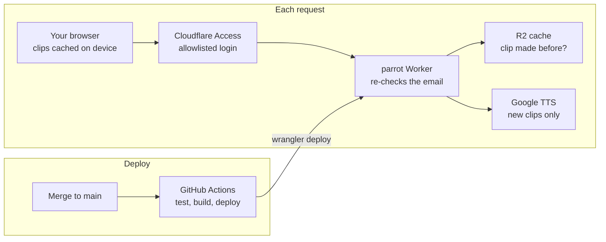

# Deploying Parrot

About 45 minutes of one-time setup gets Parrot live at
`https://parrot.<your-subdomain>.workers.dev`, behind a login, redeploying itself on
every merge to `main`.

What you end up with:

- **One Cloudflare Worker** serving the app and the `/api/*` routes.
- **An R2 bucket** (`parrot-audio`) caching every synthesized clip, so each word is paid for once.
- **Cloudflare Access** in front of the site: only allowlisted emails can sign in, and the
  Worker re-checks the email on every API call.
- **GitHub Actions**: every pull request runs the checks; every merge to `main` checks,
  builds and deploys.



Do the steps in order. Steps 1 to 4 happen once on your laptop and in dashboards; after
step 5, deploys happen by merging.

## Step 1: Google API keys

Use dedicated keys with restrictions. Never paste a key into chat, an issue or the repo.

- [ ] In the [Google Cloud console](https://console.cloud.google.com) →
  **APIs & Services → Credentials**, delete any key that has been shared anywhere.
- [ ] **+ Create credentials → API key**, name it `parrot-server`.
  - API restrictions: **Restrict key** → only **Cloud Text-to-Speech API**.
  - Application restrictions: **None** (Cloudflare has no fixed IP).
- [ ] Optional, only if you want to paste a key into the app's Settings page:
  **+ Create credentials → API key** again, name it `parrot-browser`.
  - API restrictions: only **Cloud Text-to-Speech API**.
  - Application restrictions: **Websites** → `http://localhost:5173/*` and, after step 3,
    `https://parrot.<your-subdomain>.workers.dev/*`.
- [ ] **Billing → Budgets & alerts**: create a budget (for example $5) with email alerts.

Keep `parrot-server` handy for step 3.

## Step 2: Cloudflare account and R2 bucket

The Worker and R2 run on Cloudflare's free tier for personal use; R2 needs a payment
method on file but includes 10 GB free.

**Don't create an application in the dashboard.** The `parrot` Worker is created by
`npm run deploy` in step 3, from the settings in `wrangler.jsonc`. If the dashboard shows
"Make something new" (Connect GitHub, Hello World, template, upload), close it. (Connect
GitHub would make Cloudflare deploy on every push as well, doubling up with step 5.)

- [ ] Sign up or log in at [dash.cloudflare.com](https://dash.cloudflare.com).
- [ ] **Workers & Pages**: if asked, pick your `workers.dev` subdomain. The app's address
  becomes `https://parrot.<subdomain>.workers.dev`. Not asked? You already have one; it's
  shown on the Workers & Pages overview, and `npm run deploy` prints the full address.
- [ ] **R2 Object Storage**: open it once and enable R2.
- [ ] On your laptop, in the `parrot` folder:

  ```sh
  git pull
  npm install
  npx wrangler login
  npx wrangler whoami
  npx wrangler r2 bucket create parrot-audio
  ```

- [ ] If `r2 bucket create` asks "Would you like Wrangler to add it on your behalf?", answer
  **no** (or press Ctrl+C). `wrangler.jsonc` already binds the bucket as `AUDIO`; letting
  Wrangler add it creates a duplicate binding. If it slipped in, `git checkout wrangler.jsonc`.
- [ ] Write down the **Account ID** that `wrangler whoami` prints (also shown on the
  **Workers & Pages** overview page). You need it in step 5.

## Step 3: First deploy and Worker secrets

Deploy once by hand so the Worker exists, then give it its secrets. Secrets survive every
later deploy, including the ones from GitHub. All Worker configuration is secrets, not
`vars`, for exactly that reason.

- [ ] Deploy:

  ```sh
  npm run deploy
  ```

- [ ] Open the address it prints. The app loads, but nothing protects it yet, and `/api/*`
  answers 401 because the server isn't configured. That's expected.
- [ ] Set the first two secrets (each command prompts for the value, so it never lands in
  your shell history):

  ```sh
  npx wrangler secret put GOOGLE_TTS_API_KEY   # the parrot-server key
  npx wrangler secret put ALLOWED_EMAILS       # you@example.com (comma-separated for several)
  ```

The other two secrets, `ACCESS_TEAM_DOMAIN` and `ACCESS_AUD`, come from step 4.

## Step 4: Cloudflare Access login

Access puts a login page in front of the whole site, free for up to 50 users. You turn it
on from the Worker itself; Cloudflare creates the Access application and policy for you.
(Menus as of late 2026; Cloudflare renames things often, so if a label differs, look for
the closest match.)

- [ ] **Zero Trust** (dashboard sidebar) → **Overview**: if it's your first visit, finish
  the short onboarding (pick a **team name** and the **Free** plan); Access can't be turned
  on for a Worker until this is done. Already set up? The **Account details** card shows
  your **Team name** and plan. Your team domain is `<team-name>.cloudflareaccess.com`.
- [ ] **Workers & Pages → parrot → Domains** tab → **Worker URL** section: turn on
  **Cloudflare Access** for the `workers.dev` URL. (Older dashboards:
  **Settings → Domains & Routes → Enable Cloudflare Access**.)
- [ ] The confirmation that appears shows two values. Copy both:
  - the **team domain**, like `<team-name>.cloudflareaccess.com`
  - the **AUD** (application audience) tag, a long hex string

  Cloudflare's sample code labels them `TEAM_DOMAIN` and `POLICY_AUD`.
- [ ] Choose **Manage Cloudflare Access** and check who the policy allows. It should be an
  **Allow** policy whose rule includes only your email(s): **Include → Emails**, the same
  addresses as `ALLOWED_EMAILS`. Remove anything broader, like "Everyone" or a whole
  email domain.
- [ ] Login methods: new Zero Trust accounts only offer **sign in with Cloudflare**, limited to
  members of your Cloudflare account. Anyone else sees "Cloudflare sign-in is restricted to
  members of the account". To let other people in by email:
  - **Zero Trust → Integrations → Identity providers** (older dashboards:
    **Settings → Authentication**) → **Add new → One-time PIN** → save.
  - In the parrot application → **Configure → Login methods**, tick **One-time PIN** and save.

  They'll get a code by email. Codes are only sent to addresses your policy allows.
- [ ] Set the last two secrets:

  ```sh
  npx wrangler secret put ACCESS_TEAM_DOMAIN   # <team-name>.cloudflareaccess.com (no https://)
  npx wrangler secret put ACCESS_AUD           # the AUD tag
  ```

Lost the values? In **Zero Trust → Access controls → Applications**, open the parrot
application → **Configure → Additional settings → Application Audience (AUD) Tag**. The
team domain is the **Team name** from **Zero Trust → Overview → Account details**, followed
by `.cloudflareaccess.com`.

To add a person later: add their email to the policy's **Include → Emails** rule, and run
`npx wrangler secret put ALLOWED_EMAILS` with the **full** comma-separated list (it replaces
the old value).

The emails in the Access policy and in `ALLOWED_EMAILS` must match. Someone only in the
policy can open the site but gets "This account is not allowed" on every audio request.

## Step 5: Continuous deploy from GitHub

The workflow is in `.github/workflows/deploy.yml`. It needs two GitHub secrets; until they
exist, the deploy step is skipped with a warning.

- [ ] Create a Cloudflare API token: **My Profile → API Tokens → Create Token →
  Edit Cloudflare Workers** template.
  - Account Resources: your account.
  - Zone Resources: **All zones from an account** (the Worker uses no custom domain).
  - Optional: set an expiry and a calendar reminder.
- [ ] In GitHub, **Settings → Secrets and variables → Actions → New repository secret**:

  | Secret | Value |
  | --- | --- |
  | `CLOUDFLARE_API_TOKEN` | the token from above |
  | `CLOUDFLARE_ACCOUNT_ID` | the Account ID from step 2 |

- [ ] **Actions → CI and deploy → Run workflow** on `main` to test it without a new commit.

What runs when:

- **Pull request:** typecheck, tests, build. Nothing deploys.
- **Merge or push to `main`:** the same checks, then `wrangler deploy`. A failed check
  blocks the deploy, and two deploys never run at once.
- Each deploy shows up under the repo's **production** environment with a link to the site.

## Step 6: Check it works

On a computer:

- [ ] In a private window, open the site. You get the Cloudflare Access login, not the app.
- [ ] Sign in (one-time code by email). The app loads with **no** "add your API key" banner,
  which means server mode works.
- [ ] Import a short list, open **Practice**, and start a session. You hear real audio.
- [ ] Sign in with an email that is not on the list. Access refuses it.
- [ ] Merge a tiny change to `main` and watch **Actions** deploy it.
- [ ] **R2 → parrot-audio**: the `tts/` folder holds the clips you just generated.

On your phone, where Parrot is meant to be used:

- [ ] Open the site, sign in, then install it: **Settings → Install the app** shows the
  steps (iPhone: Share → Add to Home Screen).
- [ ] Open Parrot from the home screen icon and import your list **there**. On iPhone the
  installed app has its own storage, separate from Safari.
- [ ] Wait for **Ready offline** on the list, then turn on airplane mode, open Parrot and
  start a session. It plays with no connection.
- [ ] Lock the phone mid-session: audio keeps playing, and the lock screen shows the
  current word with skip buttons.

## Troubleshooting

| You see | Cause | Fix |
| --- | --- | --- |
| Yellow "add your API key" banner after logging in | A Worker secret is missing, so `/api/*` answers 401 | `npx wrangler secret list` should show all four secrets; add the missing one |
| "No allowed emails are configured" | `ALLOWED_EMAILS` not set | `npx wrangler secret put ALLOWED_EMAILS` |
| "Cloudflare sign-in is restricted to members of the account" | The app only offers Cloudflare-account login | Add **One-time PIN** as a login method (step 4) |
| "Google's per-minute limit reached" or "usage limit is still reached" | A Text-to-Speech quota was hit, usually "Count of requests for Chirp3-HD voices per minute" (200 by default). Parrot paces itself to ~180 requests a minute, waits and retries, and lets you practice the words already downloaded | Google Cloud → **IAM & Admin → Quotas & System Limits** → filter "Text-to-Speech" → select the metric near 100% → **Edit quota**. Needs a paid billing account |
| "Your sign-in has expired. Tap to sign in again." | The Cloudflare Access session ran out (common in the installed app after a few weeks) | Tap the banner, or reopen the app while online, and sign in; downloaded lists keep playing meanwhile |
| "This account is not allowed" | Signed in with an email missing from `ALLOWED_EMAILS` | Add it there and in the Access policy |
| "Invalid Cloudflare Access token" | `ACCESS_AUD` or `ACCESS_TEAM_DOMAIN` doesn't match the Access application | Re-copy the AUD tag (Step 4, "Lost the values?"); the domain is only `<team>.cloudflareaccess.com` |
| "The Cloud Text-to-Speech API isn't enabled" | API not enabled in the key's Google project | Google Cloud → APIs & Services → Library → enable it |
| Deploy fails with "bucket not found" | R2 bucket missing | `npx wrangler r2 bucket create parrot-audio` |
| Actions deploy step says "Skipping deploy" | GitHub secrets missing | Step 5 |
| Actions deploy fails with "Authentication error" | Token expired, revoked or missing Workers permission | New token from the Edit Cloudflare Workers template; update `CLOUDFLARE_API_TOKEN` |
| Site opens without a login page | Access not enabled on the `workers.dev` URL | Step 4, second checkbox (Worker → **Domains** tab) |
| No install option, or a blank home screen icon | The browser fetched the manifest or icons without the Access cookie | In **Zero Trust → Access controls → Applications**, add a self-hosted application for `/manifest.webmanifest` and `/icons/*` on the same hostname with a **Bypass, Everyone** policy |
| Installed app shows the login page after weeks offline | The Access session expired | Open it online and sign in again; downloaded lists keep working offline either way |

For anything else, the Worker's live logs: `npx wrangler tail`, or
**Workers & Pages → parrot → Logs**.
